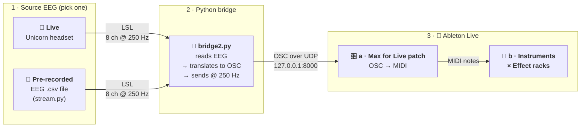

# music-and-mojo: EEG → Ableton Live

Turn brain activity into MIDI notes in Ableton Live. Live EEG from a g.tec Unicorn headset, or a recorded EEG file, goes over LSL into Python. Python sends it on as OSC over UDP to a Max for Live device, and the device plays notes on an instrument track.

## Pipeline




## Usage (Windows, PowerShell; **not WSL**)

WSL2 has its own network, so its `127.0.0.1` is not Windows' `127.0.0.1`, and UDP from WSL never reaches Ableton. Run all three steps in Windows PowerShell or cmd.

1. **Ableton:** open your set. On a MIDI track, drop `max/EEG-MIDI-Controls.amxd` before an instrument.
2. **Source.** Open one terminal in the repo folder and activate the environment:
   ```powershell
   cd C:\Users\19518\Downloads\music-and-mojo
   .\venv\Scripts\Activate.ps1          # cmd.exe: venv\Scripts\activate.bat
   ```
   - For a recorded session, run `python stream.py`. It prints `streaming 250 Hz …` every 5 s and loops the file.
   - For the live headset, start the Unicorn LSL app instead. Then, in `bridge2.py`, set `STREAM_NAME = 'UnicornRecorderLSLStream'`.
3. **Bridge.** In a second terminal (activate again), run `python bridge2.py`. It should print about `sent 250 msgs/s to 127.0.0.1:8000, last …, range …` every second.
4. **Play.** In the device:
   - The raw box moves and the note box changes.
   - Leave **Auto Range** on, and turn **Note Every** to set the tempo.

First-time setup is `python -m venv venv`, then activate, then `pip install -r requirements.txt`. The scripts need `pylsl`, `python-osc` and `numpy`; `bridge.py` also needs `mne`.

## Files

| File | What it does |
|---|---|
| `stream.py` | Replays a recorded EEG CSV (`data/…csv`, 8 channels) as a live LSL stream called `SpoofedEEG` at 250 Hz. It loops at the end of the file and paces by a running clock, so the rate stays at 250 Hz. |
| `discover_streams.py` | Lists every LSL stream on the network (name, type, channels, rate). Run it first when the bridge says "No stream named …". |
| `bridge3.py` | `bridge2.py`, altered by Claude. |
| `bridge2.py` | The main bridge. It reads one channel (`CHANNEL = 7`) from the named LSL stream and sends each sample as `/eeg/processed`. Once a second it also sends `/eeg/range` (the 5th–95th percentile of the last 10 s) for Auto Range. It prints a msgs/s line. |
| `bridge.py` | Experimental bridge. It computes alpha (8–12 Hz) band power with MNE (Welch, 1 s window, every 10 samples) on one channel of the Unicorn stream, and sends `/eeg/alpha_power`. |
| `requirements.txt` | Python packages. |
| `max/EEG-MIDI-Controls.amxd` | Max for Live MIDI effect with on-device controls (see below). Every control can be MIDI-mapped and automated. |
| `max/ch8VisualMIDI.amxd` | The original proof-of-concept device, kept as the known-good fallback. |
<!-- | `gpu_custom_unicorn_dashboard.py` | Live dashboard for the Unicorn stream. | -->
<!-- | `midiTest.py` | Small MIDI output test. | -->
<!-- | `data/`, `*.csv`, `*.npy` | EEG recordings. **Not in git** (see `.gitignore`); keep them on the laptop or a shared drive. | -->

## Device controls (EEG-MIDI-Controls)

| Control | What it does | Default |
|---|---|---|
| Auto Range | On: the input range follows the signal (from `bridge2.py`'s `/eeg/range`). Off: uses In Low / In High. | on |
| In Low / In High | Manual input range of the raw value (the old `scale` min/max). Used when Auto Range is off. | 119000 / 122000 |
| Note Low / Note High | Lowest and highest MIDI note. Values outside the range are clipped. | 35 / 54 |
| Note Every | Time between notes in ms (replaces `zl group 35`). The box under it shows notes per second. | 700 ms |
| Velocity | Note velocity. | 100 |
| Length | Note length in ms. Each note now ends on its own. | 500 ms |
| MIDI ch | Output channel. | 2 |

To put a control on a MIDI knob, press Ctrl+M (Cmd+M on Mac) in Live, click the control, turn the knob, then press Ctrl+M again.

## Troubleshooting

| Symptom | Check |
|---|---|
| `No stream named 'SpoofedEEG'` | Is `stream.py` (or the Unicorn LSL app) running? Run `python discover_streams.py`, and set `STREAM_NAME` to the name it shows. |
| Bridge prints msgs/s but Ableton shows nothing | Are you running the bridge in WSL? Use PowerShell. Is the device's port 8000? Is anything else using UDP 8000? In PowerShell: `Get-NetUDPEndpoint -LocalPort 8000`. |
| `No samples for 2 s` | The source stopped. Restart `stream.py`, or check the headset's battery and Bluetooth. |
| One note repeats, or it stays at the lowest or highest note | Turn Auto Range on, or widen In Low / In High around the `range …` numbers the bridge prints. |
| Hanging notes | Use the new device: `makenote` sends note-offs. |
| Ableton crashed | Reopen the set. Python keeps sending, because UDP doesn't need a connection, so the device picks the data up again as soon as it loads. |
