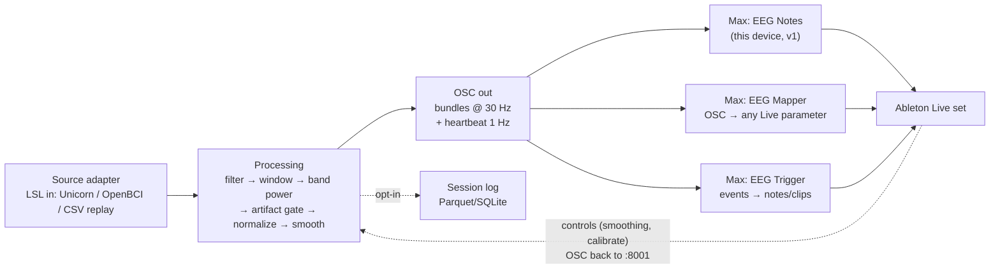

# EEG → Music Kit: design spec (spec-driven)

Status: draft for discussion · 2026-10-18 · Owner: Sina Radi · Contributors: Erik, Ryan, Alex

The spec has three parts: **Requirements** (what must be true, testable), **Design** (how), and **Tasks** (ordered, each traced to requirements). The proof of concept (one channel, one note stream) is v0. This spec takes it to v1, a dependable instrument for live sets, and v2, a kit others can install.

---

## 0. Goals and non-goals

**Goals**
- A performer should never have to open the Max patch during a set.
- More of the brain signal reaches Ableton (several channels and features), stable enough to play musically.
- When anything fails (headset, Python, Ableton), the music degrades gracefully and recovers by itself.
- Someone outside the team can install it from the docs alone.

**Non-goals**
- No medical, diagnostic or wellness claims. This is a musical instrument.
- No cloud services. Everything runs on the performer's laptop.
- No guarantee that a given person's signal will do a given thing. People differ a lot (alpha, for example, is clear for some, flickery or weak for others). Design for a continuous level and a calibration step, not for on/off magic.

---

## 1. Requirements

Format: user story, then acceptance criteria in EARS form ("WHEN … THE SYSTEM SHALL …").

### R1 · Device UI (idea 1)
*As a performer, I control every musical parameter from the device face or a MIDI knob.*
- R1.1 THE device SHALL show input range, note range, rate, velocity, length and channel as Live parameters (automatable, MIDI-mappable, saved with the set).
- R1.2 WHEN Auto Range is on, THE device SHALL take its input range from the bridge without user action.
- R1.3 WHEN rate is set in ms, THE note tempo SHALL NOT depend on the incoming sample rate.
- R1.4 WHEN any value arrives outside the input range, THE device SHALL clip it to the note range.
- R1.5 WHEN the rate is set to a note value (1/4, 1/8, …), THE device SHALL sync note timing to Live's transport. *(v1)*

### R2 · More EEG streams (idea 2)
*As a performer, I map several brain signals to several Live parameters.*
- R2.1 THE bridge SHALL send any subset of channels and features, chosen in a config file, not in code.
- R2.2 THE bridge SHALL send all values for one time step in one OSC bundle.
- R2.3 WHILE sending 8 channels × 5 bands at 30 Hz, THE bridge SHALL keep CPU below 15 % on the show laptop, and Live SHALL show no audio dropouts *(to be measured; see T2.4)*.
- R2.4 THE kit SHALL include a mapper device that sends any OSC address to any Live parameter, with a range and a curve.

### R3 · ML / data pipeline (idea 3)
*As a performer, I get a stable, musically useful level that adapts as the signal drifts.*
- R3.1 THE bridge SHALL compute band power (delta, theta, alpha, beta, gamma) per channel on a sliding window (default 1 s, hop 100 ms).
- R3.2 THE bridge SHALL normalize each feature to 0–1 against a rolling baseline, so drift and between-person differences don't need manual retuning.
- R3.3 WHEN a calibration is run (30 s eyes open, then 30 s eyes closed), THE bridge SHALL store that person's range and use it for normalization.
- R3.4 WHEN an artifact (blink, jaw clench, cable bump) exceeds a threshold, THE bridge SHALL hold the last good value and MAY emit it as an event (`/eeg/event/blink`) that can be played on purpose.
- R3.5 THE smoothing amount SHALL be a live control (from the device), not a constant.
- R3.6 THE bridge SHALL run the processing for 8 channels within one hop (100 ms) on the show laptop.

### R4 · Ableton set / sound palette (idea 4)
- R4.1 THE kit SHALL ship one template Live set: an EEG MIDI track (device + Scale + instrument), an EEG modulation track (mapper → filter, reverb, etc.) and a backing track.
- R4.2 Each instrument preset SHALL be chosen to sound good across the whole note range the device can produce.

### R5 · Failsafe (idea 5)
- R5.1 WHEN no data arrives for 2 s, THE device SHALL glide to a neutral "rest" state (a held note or a fade), not stop abruptly, and SHALL show "no signal".
- R5.2 WHEN data resumes, THE device SHALL return within 1 s with no user action.
- R5.3 WHEN Ableton restarts, THE pipeline SHALL resume without restarting Python. UDP is connectionless, so this already holds; keep it.
- R5.4 WHEN the headset drops, THE operator SHALL switch to CSV replay with one command, and the stream name SHALL stay the same (`EEG_SOURCE=replay`).
- R5.5 THE bridge SHALL send `/eeg/heartbeat` once a second with the sample rate and the source name.

### R6 · Documentation (idea 6)
- R6.1 THE README SHALL let a new person reach sound in ≤ 15 minutes on Windows and on macOS.
- R6.2 THE troubleshooting table SHALL list every failure seen in rehearsal, with a symptom → check → fix row.
- R6.3 A one-page show-day checklist SHALL exist (start order, sound check, fallbacks).

### R7 · History / database (idea 7)
- R7.1 WHEN a performer opts in, THE bridge SHALL log raw samples and features to a local file (Parquet or SQLite), one file per session, with a session note.
- R7.2 THE bridge SHALL NOT log anything by default. EEG is personal data: the wearer agrees first, and recordings stay out of git.
- R7.3 A replay tool SHALL play any logged session back as an LSL stream (this extends `stream.py`).

### R8 · Open-source kit (v2)
- R8.1 THE code SHALL install with `pip install` (Python) and as a Max package or a folder of `.amxd` devices.
- R8.2 THE kit SHALL work with any LSL source: Unicorn, OpenBCI, Muse via a bridge app, or a CSV.
- R8.3 THE kit SHALL include tests that run with no headset (synthetic stream) in CI.
- R8.4 THE kit SHALL include no recordings of real people.

---

## 2. Design

### 2.1 Architecture



Python does the signal processing, which is testable, has numpy and MNE, and is cheap. Max does the musical decisions (range, tempo, scale, mapping), where a performer can reach them. One-way data at 30 Hz is plenty for musical control. Raw 250 Hz stays available for experiments.

### 2.2 OSC address scheme (v1)

| Address | Args | Rate | Notes |
|---|---|---|---|
| `/eeg/processed` | f | 250 Hz | v0, kept so old devices work |
| `/eeg/range` | f f | 1 Hz | v0.1 (now): 5th–95th percentile, last 10 s |
| `/eeg/raw/<ch>` | f | 250 Hz | optional; in a bundle per sample |
| `/eeg/band/<band>/<ch>` | f | 30 Hz | absolute band power (µV²) |
| `/eeg/level/<band>/<ch>` | f 0–1 | 30 Hz | normalized + smoothed: **the one to map** |
| `/eeg/level/<band>` | f 0–1 | 30 Hz | mean over the chosen channels |
| `/eeg/event/<name>` | f strength | on event | blink, jaw, alpha_up, … |
| `/eeg/quality/<ch>` | f 0–1 | 1 Hz | contact / noise estimate |
| `/eeg/heartbeat` | f rate, s source | 1 Hz | for the "no signal" logic |
| `/eeg/ctl/<name>` (to bridge :8001) | f | on change | smoothing, calibrate, source switch |

Load: 8 ch × 5 bands × 30 Hz = 1,200 values/s in 30 bundles/s. The current bridge already sends 250 single messages/s, and the kit's measurement put one message at about 14 µs (about 70,000 msgs/s), so this is well within budget. Measure Live's side in T2.4.

### 2.3 Processing (Python, numpy first, MNE where it helps)

1. **Filter:** 1–40 Hz band-pass plus a 50/60 Hz notch (`mne.filter.filter_data` once per hop, or `scipy.signal.sosfilt` with kept state, which is cheaper for streaming).
2. **Window:** 1 s ring buffer per channel, hop 100 ms.
3. **Band power:** Welch PSD (`mne.time_frequency.psd_array_welch`, as `bridge.py` does now), summed per band, on a log scale (`log10`). Log power is far more stable to map than raw power.
4. **Artifact gate:** a peak-to-peak or z-score threshold per window. Over the threshold, hold the last value and emit an event.
5. **Normalize:** a z-score against a rolling baseline (an EWMA mean and variance over about 30–60 s), then squashed to 0–1 (logistic). After a calibration, use that person's eyes-open / eyes-closed means as 0 and 1 instead. This replaces manual scale tuning for good.
6. **Smooth:** a One-Euro filter (smooth when still, quick when the signal moves). It suits performance better than a plain moving average, and its two knobs (min cutoff, beta) become device controls.
7. **Learning, step by step (only after 1–6 work):**
   - a. adaptive normalization (step 5) is already "learning the drift";
   - b. a 2-class LDA or logistic model (eyes open vs closed, or calm vs focused) trained in the 60 s calibration and sending a probability as `/eeg/level/state`;
   - c. later, unsupervised (k-means / HMM over band-power vectors) to find a performer's own recurring states and give each a sound. Keep models small and on-device; log only with consent.

### 2.4 Max devices

- **EEG Notes:** the current v1 device, plus: rate as ms *or* synced note values (`live.observer` on the tempo, or `transport`-based `metro @interval 8n`), quantize to a scale, a "no signal" glide.
- **EEG Mapper:** OSC address menu, then a target picked with a **Map** button (`live.remote~` + a parameter picker, the way Ableton's own LFO / Envelope Follower devices map), min/max, curve and smoothing. Use one device per mapping; stack as many as needed.
- **EEG Trigger:** events → note or clip launch, with a cooldown.
- Shared: one `udpreceive` per device is fine on one port. If two devices fight for the port, use one "EEG Hub" device that receives and forwards with `send`/`receive` (or `[udpreceive]` with each device on its own port; config per device).

### 2.5 Failsafe design

- **Watchdog in Max:** a `/eeg/heartbeat` → `[delay 2000]` re-armed on each beat. When it fires, a glide to rest and "no signal" shows.
- **Source switch:** one launcher (`run.ps1` / `run.sh`) starts the source and the bridge and restarts them if they exit. `EEG_SOURCE=unicorn|replay`.
- **Ableton:** keep CPU headroom (freeze heavy tracks), save the set before the show, and keep a "safe" set with the v0 device ready. Live's crash recovery restores the last state; Python needs no restart (R5.3).
- **Rehearse failures:** pull the headset, kill Python, quit Live, each once per rehearsal. Note the recovery time in the troubleshooting table.

### 2.6 Repo layout (v1 → v2)

```
music-and-mojo/
  eeg2osc/            # Python package: sources/, processing/, osc.py, config.py, log.py
  devices/            # .amxd: EEG Notes, EEG Mapper, EEG Trigger (+ .maxpat sources)
  sets/               # template Live set
  configs/            # default.yaml (channels, bands, addresses, rates)
  tools/              # stream.py (replay), discover_streams.py, calibrate.py
  tests/              # synthetic-stream tests, OSC round-trip tests
  docs/               # README, SHOW-DAY, TROUBLESHOOTING, this spec
```

---

## 3. Tasks

Each task names the requirements it serves and how it is checked. Order matters; each phase leaves something that works.

### Phase 0: done 10-18 (demo kit)
- [x] T0.1 bridge2 stream-name lookup, a timeout and a msgs/s line (R6.2). Checked: 250 msgs/s end to end on a test machine.
- [x] T0.2 `/eeg/range` auto range (R1.2). Checked: range messages received once a second.
- [x] T0.3 stream.py deadline pacing and a loop (R5.4). Checked: 250 Hz (it was 35 Hz with a plain sleep under load).
- [x] T0.4 the EEG-MIDI-Controls device (R1.1, R1.3, R1.4). Checked by script; **still needs a check in Live**.
- [x] T0.5 README, .gitignore, git steps (R6.1).

### Phase 1: dependable instrument (v1)
- [ ] T1.1 Config file instead of constants (stream name, channel, port) (R2.1). *Test: change the channel in the config, and the bridge sends it.*
- [ ] T1.2 Heartbeat plus the Max watchdog and a "no signal" glide (R5.1, R5.2, R5.5). *Test: kill stream.py; the device shows no signal within 2 s and recovers within 1 s of a restart.*
- [ ] T1.3 Launcher script with a source switch and auto restart (R5.4).
- [ ] T1.4 Transport-synced rate (R1.5).
- [ ] T1.5 Show-day checklist and a rehearsed failure table (R6.2, R6.3).

### Phase 2: richer signal
- [ ] T2.1 Processing module: filter, band power, log, per channel (R3.1). *Test: a synthetic 10 Hz sine gives an alpha level above the other bands.*
- [ ] T2.2 Rolling normalization and the One-Euro smoother, with smoothing controllable over OSC (R3.2, R3.5). *Test: a slow DC drift on the synthetic stream leaves the level within ±0.05.*
- [ ] T2.3 Artifact gate and events (R3.4). *Test: injected spikes give a held value and one event each.*
- [ ] T2.4 Load test: 8 ch × 5 bands × 30 Hz into Live with a heavy set. Record CPU and dropouts with the machine and what else was running (R2.3, R3.6).
- [ ] T2.5 EEG Mapper device (R2.4).
- [ ] T2.6 `calibrate.py`: 30 s + 30 s with spoken or on-screen prompts, saving a per-person profile (R3.3).

### Phase 3: learning and history
- [ ] T3.1 Opt-in session logging plus replay of logged sessions (R7.1–R7.3).
- [ ] T3.2 Calibration-trained 2-class model → `/eeg/level/state` (R3, step 7b). *Test: on held-out calibration data, AUC above chance, reported honestly per person.*
- [ ] T3.3 Template Live set and sound palette (R4.1, R4.2).

### Phase 4: open-source kit (v2)
- [ ] T4.1 Package `eeg2osc` (pyproject, `pip install -e .`), with CI running the synthetic tests on Windows and macOS (R8.1, R8.3).
- [ ] T4.2 Source adapters for OpenBCI (BrainFlow → LSL) and generic LSL (R8.2).
- [ ] T4.3 Licence (for example MIT for the code, CC-BY for the docs), contributor guide, no real-person data (R8.4).
- [ ] T4.4 Public docs site and a demo video, made with the wearer's consent.

---

## 4. Open questions

1. Which signals feel most playable to Alex: alpha level, beta/alpha ratio, blinks as triggers? Decide by playing each in rehearsal (Phase 2), not on paper.
2. One device per function (Notes, Mapper, Trigger) or one "hub" device? The recommendation is separate devices on one shared receiver (2.4).
3. Should the kit stay team-internal until the template set and the failure drills are solid? The recommendation is yes: publish after Phase 2.
4. Name and licence for the public kit.
